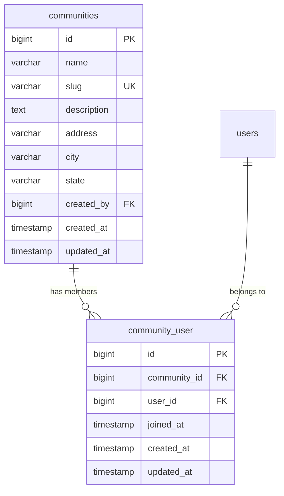
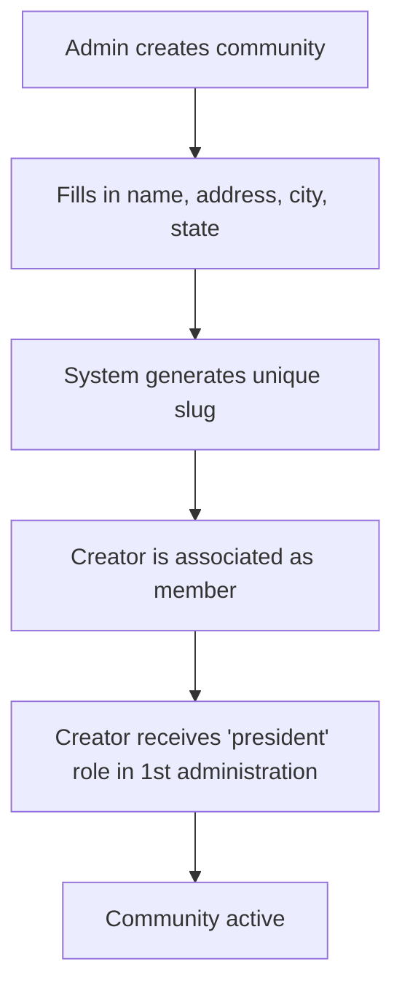
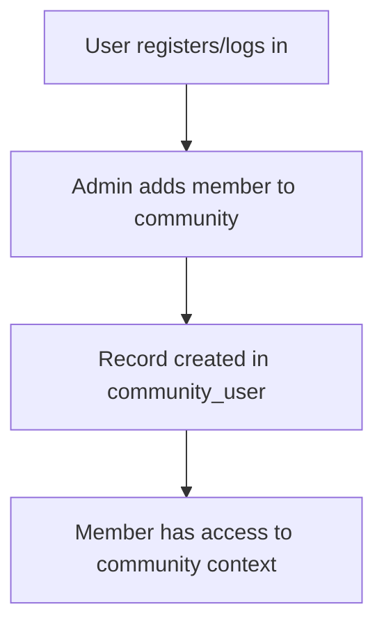

# Multi-tenant: Community

Based on the prayer-community structure (`communities` + `community_user`).
Each community is independent. A user can belong to more than one.

## Implementation Status

> Checked on 2026-11-10.

| Flow             | Status                   | Implementation                                                                                                                                                                                                                             |
| ---------------- | ------------------------ | ------------------------------------------------------------------------------------------------------------------------------------------------------------------------------------------------------------------------------------------ |
| Create Community | ✅ Implemented           | `CreateCommunity` creates the community, attaches the creator as President, seeds the default positions and the first administration, and switches the user to the new community.                                                          |
| Join Community   | ⚠️ Partially implemented | `RegisterMember` creates the user, profile and `community_user` pivot from the members area, and users can belong to multiple communities and switch contexts. There is no flow to attach an already-registered user to another community. |

## Data Model

## Flow: Create Community

## Flow: Join Community

