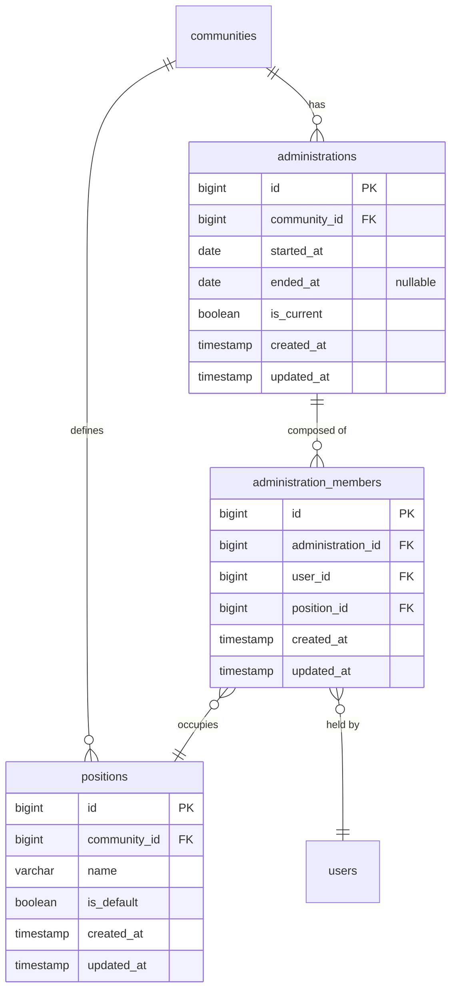
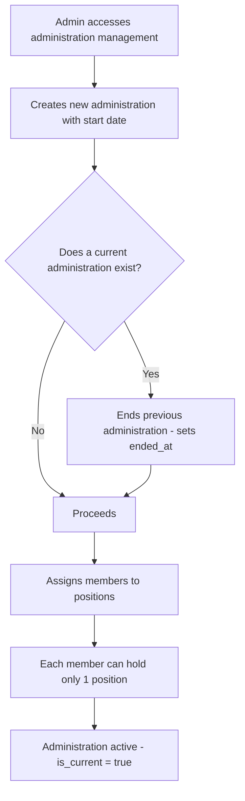
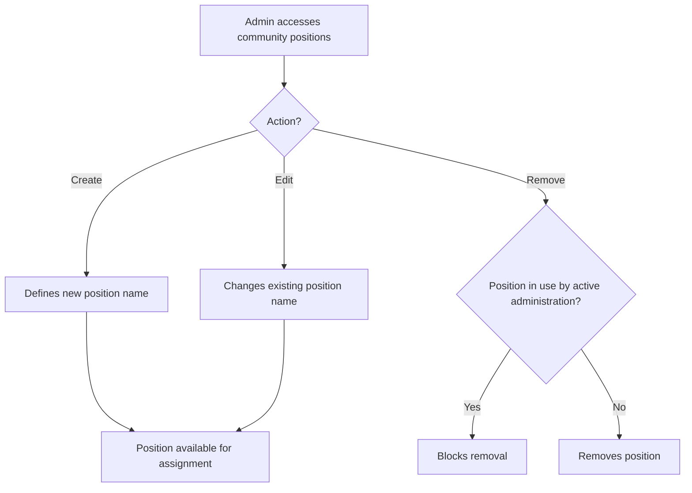
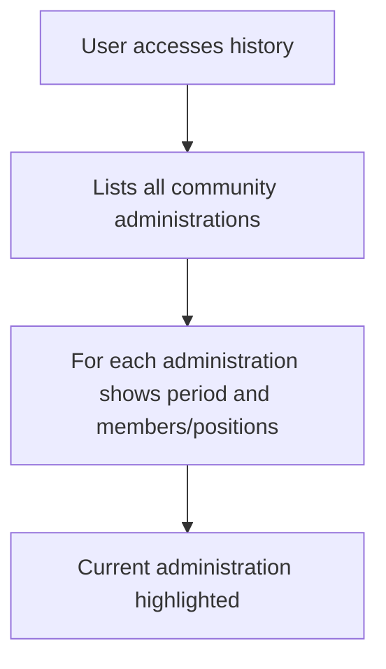

# Administrations and Positions

Each community can define its own positions (roles).
Default initial positions: President, Vice-President, Secretary, Treasurer.
An administration has a period (start/end). History is preserved.
A member can hold only one position at a time.

## Implementation Status

> Checked on 2026-11-10.

| Flow                      | Status         | Implementation                                                                                                                                                                       |
| ------------------------- | -------------- | ------------------------------------------------------------------------------------------------------------------------------------------------------------------------------------ |
| Create New Administration | ✅ Implemented | `CreateAdministration` ends the previous administration and creates the new one with the given dates; the creator is auto-assigned as President when they held that position before. |
| Manage Positions          | ✅ Implemented | `PositionController` creates and edits positions; `PositionPolicy` blocks deleting a position that is held in the current administration. Deletion is restricted to system admins.   |
| Administration History    | ✅ Implemented | `AdministrationController@index` and `@show` list every administration with its period, members and positions, highlighting the current one.                                         |

## Data Model

## Flow: Create New Administration

## Flow: Manage Positions

## Flow: Administration History

