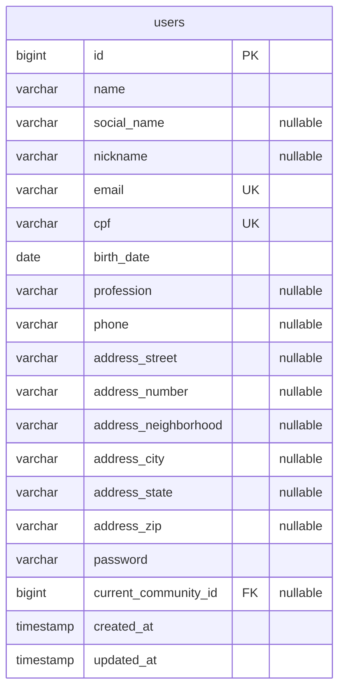
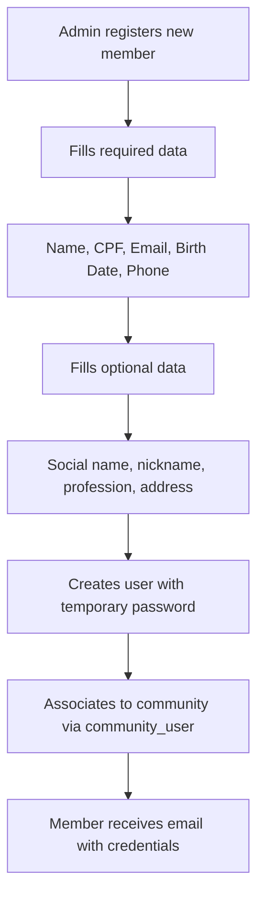

# Member Registration

Member = User with login. Required personal data per community.

## Implementation Status

> Checked on 2026-11-10.

| Flow            | Status         | Implementation                                                                                                                                                                                     |
| --------------- | -------------- | -------------------------------------------------------------------------------------------------------------------------------------------------------------------------------------------------- |
| Register Member | ✅ Implemented | `RegisterMember` creates the user with a temporary password, creates the profile, attaches the `community_user` membership and emails the credentials through the `MemberRegistered` notification. |

## Data Model

## Flow: Register Member

