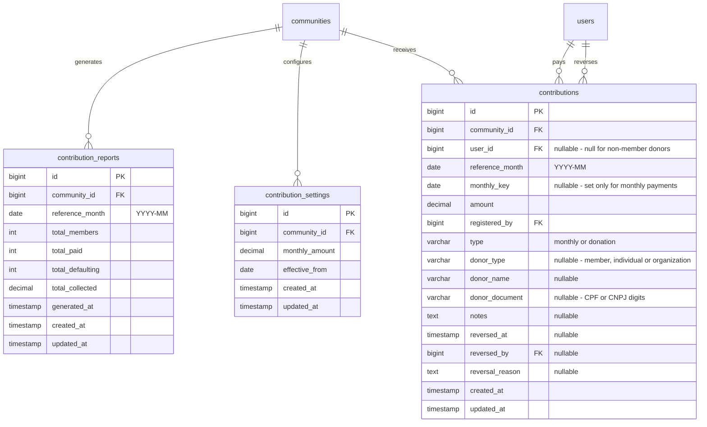
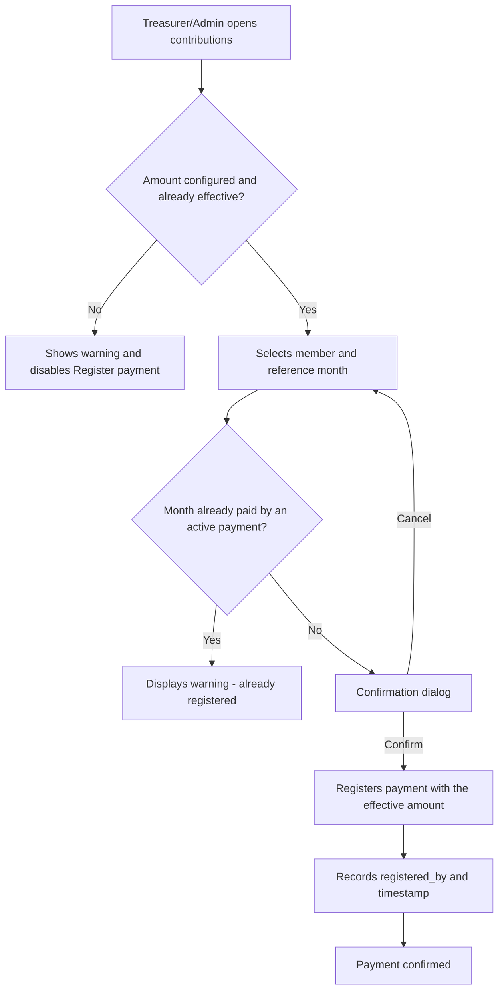
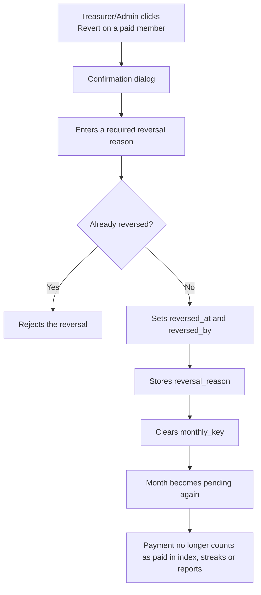
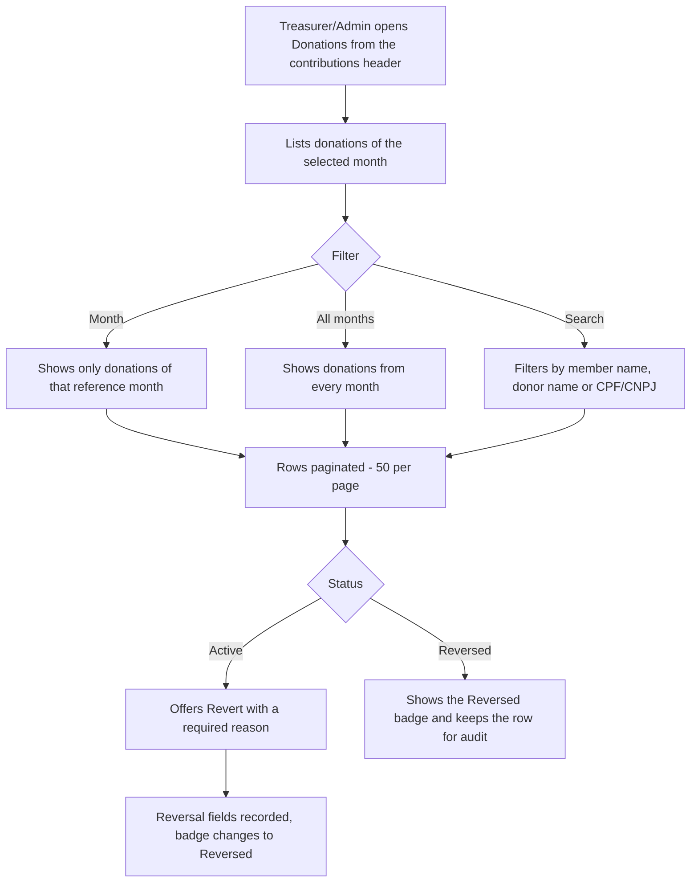
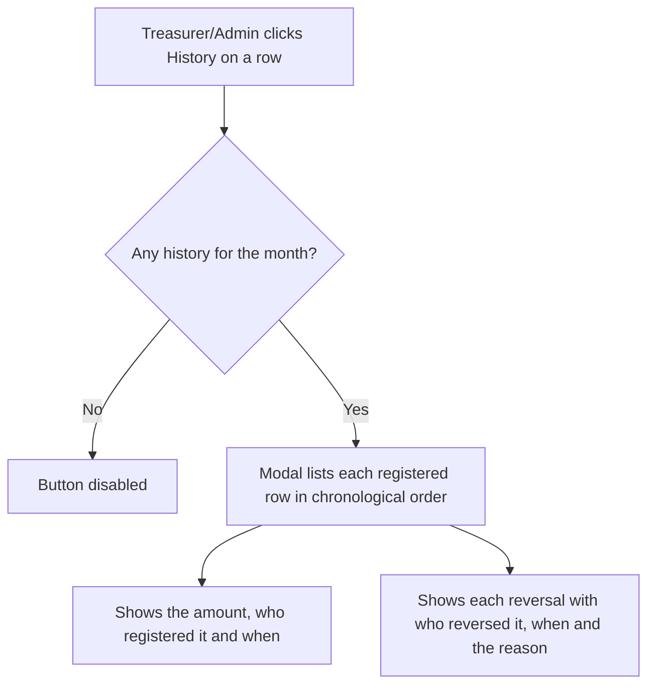
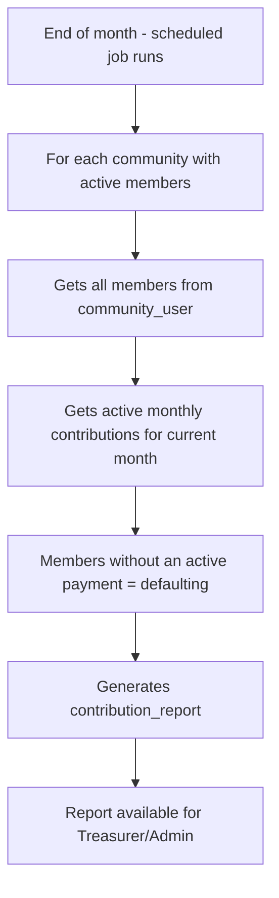
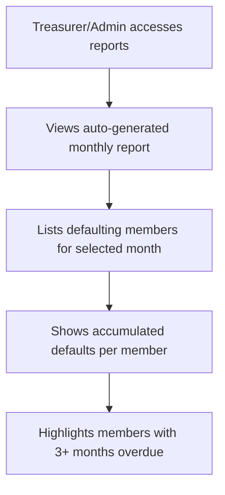
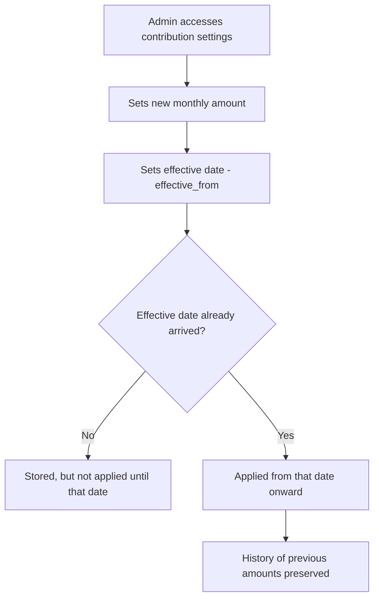
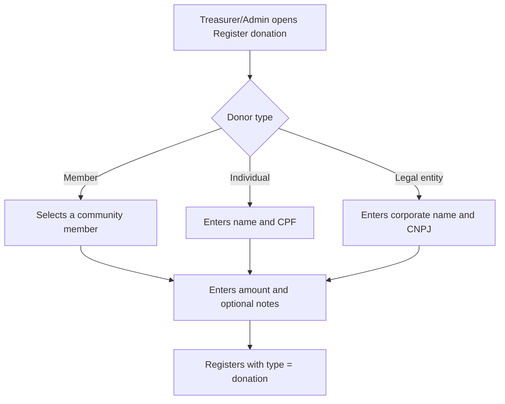
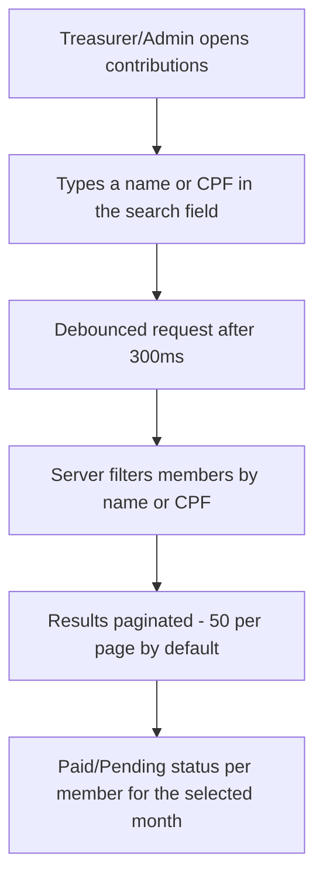

# Contributions and Donations

Mandatory monthly contribution with a fixed amount for all members.
Amount can be changed by meeting or community decision.
Donations are free, with no mandatory requirement.

The treasurer only registers members who paid. At the end of each month, an async job
automatically generates a default report by identifying members without a payment record.

A registered monthly payment can be **reversed** (voided) with an audit trail; the month
then becomes pending again and can be registered afresh.

## Data Model

Monthly duplicates are blocked by the unique index
`contributions_monthly_unique (community_id, user_id, monthly_key)`. Reversing a payment
clears `monthly_key`, so the same member/month can be registered again while the voided
row stays for audit.

## Flow: Register Monthly Payment

The effective amount is the latest `contribution_settings` row whose `effective_from`
has already arrived (today or earlier) and falls within the reference month. Future-dated
settings are ignored until their date arrives; if only future settings exist, registration
is blocked.

## Flow: Reverse Monthly Payment

Only admins and executives of the community may reverse a payment. The voided row is
kept for audit; it is excluded from the paid status, default streaks and generated report
totals. Donations use the same reversal fields and can be voided from the donations list.

## Flow: Donations Ledger

The donations list only shows rows with `type = donation`; monthly payments stay in the
contributions overview. The month defaults to the current month when the page is opened
from the contributions header, and the "All months" button removes the month filter.

## Flow: View Payment History

History is derived from the existing `contributions` rows for the selected month, including
reversed ones. A month paid, reversed and paid again therefore shows two entries: the voided
row (with its reversal metadata) and the active replacement.

## Flow: Monthly Report Generation (Async Job)

Reversed payments are ignored when computing `total_paid` and `total_collected`.

## Flow: View Payment Defaults

Reversed months count as owed again in the accumulated default streak.

## Flow: Change Contribution Amount

The latest already-effective setting wins. A future setting does not override the
currently active amount until its date arrives.

## Flow: Register Donation

Donations are not tied to the monthly amount and are never included in the default streak.
They are registered from the donations ledger, which also lists, filters and reverses them
(see "Flow: Donations Ledger").

## Flow: Find a Member in the Contributions List

## Flow: Member Views Own Payment History (planned)

Not implemented yet. Planned: the member sees every month since joining with paid/pending
status and the amount/date of paid months.
